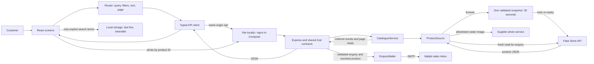

# Explain Linden Shelf

**Thirty-second explanation:** Linden Shelf is an enquiry catalogue, not a checkout. React owns navigation, accessible presentation and transient form state. Express validates HTTP input. The catalogue service chooses, filters, sorts and pages products. Two replaceable adapters handle the supplier and SMTP. No application database, account or payment is needed.

## Data Flow

| Data | Owner and lifetime |
| --- | --- |
| Product records and image bytes | The supplier is authoritative. One bounded, validated catalogue snapshot lasts 30 seconds per API process. Photos are served by product ID with a 4 MiB cap and 15-second private browser caching. A failed fetch never returns stale data as fallback. |
| Editorial picks | Five ordered IDs in server configuration (`FEATURED_PRODUCT_IDS`). Ratings are separate supplier data. |
| Search, facets, sort, current page | The URL. Back, Forward, refresh and opening a link in another tab reconstruct the view. A product tile also keeps an internal return location in history state; a direct detail URL has a safe browse fallback. |
| Recent searches | Up to five explicitly submitted terms on this browser origin. Other tabs receive storage events. Clear history removes them. Typing alone stores nothing. A shared device can expose saved terms. |
| Enquiry contact fields | Live form only until sent, cancelled or unmounted. No app database, browser history of contact details, analytics event or automatic resend. The resulting email is in the configured mailbox. |
| HTTP and assets | Canonical category, featured and detail GET successes allow a private 15-second browser cache. Search/list, POST, health and errors use `no-store`. Production fingerprinted assets cache separately; HTML revalidates. |

## Read the Code in This Order

| Open | Question to answer |
| --- | --- |
| [server.ts](../services/catalogue-api/src/server.ts) | Where are the real supplier and mailer constructed? This is the one place that wires them into the app. |
| [app.ts](../services/catalogue-api/src/app.ts) | What gets accepted over HTTP? Find the routes, allowed origins, request limit and JSON-only enquiry boundary. |
| [catalogue-service.ts](../services/catalogue-api/src/catalogue/catalogue-service.ts) | Where do the chosen IDs, category ordering and search matching live? Notice that this file never calls `fetch`. |
| [fake-store-source.ts](../services/catalogue-api/src/catalogue/fake-store-source.ts) | Where does network data become trusted product data? Follow the deadline, byte limit and [product schema](../packages/contracts/src/catalogue.ts). |
| [routes.tsx](../services/catalogue-web/src/app/routes.tsx) and [client.ts](../services/catalogue-web/src/api/client.ts) | How does a URL become a cancellable same-origin request? Browse, product detail and the enquiry form load separately. |
| [browse-page.tsx](../services/catalogue-web/src/catalogue/browse-page.tsx) and [browse-filters.tsx](../services/catalogue-web/src/catalogue/browse-filters.tsx) | Which state is a draft in a form and which is the committed URL? Why can desktop and mobile reuse the same filters? |
| [enquiry.tsx](../services/catalogue-web/src/product/enquiry.tsx) and [smtp-mailer.ts](../services/catalogue-api/src/enquiries/smtp-mailer.ts) | Which component may display success, and what evidence does it wait for? |

## Follow One Search

1. Enter `SSD`. Typing alone makes no request. Submit the [search form](../services/catalogue-web/src/app/search-bar.tsx): the URL becomes `/search?q=SSD`. Only the submitted term enters the clearable history.
2. The browse loader validates the URL. With a USD 150 ceiling, four-star minimum and low-to-high sorting, a request is `GET /api/products?q=SSD&maxPrice=150&minRating=4&sort=price-asc&page=1`. The frontend does not implement another matching algorithm.
3. Express passes the query to `CatalogueService.list`. It rejects malformed filters before fetching. The product source gets the catalogue, validates the external records, and returns products in the application's shape. TypeScript alone cannot validate network JSON at runtime.
4. The service intersects text, category, inclusive USD price bounds, rating and editorial membership. It sorts before slicing. Default category order puts picks first, explicit sort ranks the whole set, and equal sort values use ID as a stable tie-breaker.
5. A paged reply includes `products`, page-local `featuredIds` and `pagination: {page, pageSize, pageCount, total}`. The UI requests eight per page. Changing filters resets the page; an out-of-range link is replaced with the actual last-page URL. Unpaged API consumers retain the original response shape.
6. The [browse page](../services/catalogue-web/src/catalogue/browse-page.tsx) renders the server order. A tile opens `/products/:id`. The focused heading changes when navigation commits, not when loading starts. A pending navigation keeps the last screen visible, announces progress, and temporarily disables sort so it cannot replace new filters with stale ones. A failed detail photo can be retried independently of an open enquiry form.

**Explain the trade-off:** twenty products fit comfortably in one validated server snapshot; price/rating sorting and paging need no search service. Overlapping supplier requests share one promise. Browsing may briefly show an older price (the 30-second server and 15-second browser windows can stack). A much larger catalogue calls for datastore/provider-side indexes and pagination, not downloading all records to React.

## Follow One Enquiry

1. On a detail page, click **Enquire**. The browser collects name, email and an optional message. The [shared schema](../packages/contracts/src/enquiry.ts) gives fast feedback; it is applied again on the server because the browser is not a trust boundary.
2. `POST /api/enquiries` accepts a product ID and contact details, **not** a price, title, sender or sales recipient. The API explicitly bypasses the completed browse cache and resolves the product from a fresh supplier read. A customer cannot set the sales email price through the form.
3. The SMTP adapter sends plain text to the configured sales mailbox. The customer's address is `Reply-To`. It waits for the transport result and checks the intended recipient was accepted and none rejected.
4. Only a validated HTTP 200 with `{status: "sent"}` changes the form to **Thank you**. If SMTP is unavailable, the API returns 503 and the form retains the fields. The app does not retry automatically: a connection can fail after a server accepted a message, so delivery is not exactly-once.

**Show the evidence:** the [HTTP tests](../services/catalogue-api/src/app.integration.test.ts) prove a rejected or unfinished send cannot produce success. The [browser cases](../tests/browser/catalogue.spec.ts) prove the customer sees the right state. Neither proves a message arrived. Submit a synthetic enquiry and open the separate [local inbox](http://localhost:8025) to demonstrate actual local SMTP receipt.

## Accessibility and Boundaries

- One heading per screen, semantic landmarks and lists, named links, visible focus, status announcements and labelled errors. Native dialogs handle modal keyboard containment and Escape; closing restores focus. Keyboard and automated Axe tests complement, not replace, human screen-reader testing.
- Native mode trusts no forwarding headers. The protected Compose API trusts only its nginx hop. Strict schemas, bounded response/body sizes, supplier timeouts, fixed origins, fixed SMTP recipient and rate limits are enforced server-side.
- Photos and metadata are both same-origin. Production does not use fixtures. The reviewer journey rejects external browser data/image requests, decodes a real API-served image, and verifies a uniquely marked email independently in Mailpit.

## Rehearse a Live Change

**Request:** "Show the bracelet first on the home page; keep the same five products."

1. Predict the owner: this is an editorial choice, not page layout or supplier ranking. Set `FEATURED_PRODUCT_IDS=5,3,11,18,20` and restart the API (or run `docker compose up -d` for Compose). No TypeScript change is necessary.
2. Follow [startup validation](../services/catalogue-api/src/config.ts) into [the catalogue service](../services/catalogue-api/src/catalogue/catalogue-service.ts). Check that the home page puts #5 first and category picks still appear once each. The API, not React, owns the order.
3. The [service test](../services/catalogue-api/src/catalogue/catalogue-service.test.ts) also replaces members of the set. Run `npm test -- services/catalogue-api/src/catalogue/catalogue-service.test.ts`. For a **code** exercise, add a case for a second search term in the description and trace which layer would change if search became title-only.

This is a practice exercise, not a change applied to the submission. Try these questions without notes:

- **How would you replace SMTP with an HTTP email provider?** Implement `EnquiryMailer` and change the adapter constructed at startup. Keep the route and form unchanged if the provider can confirm acceptance.
- **What if an editorial pick disappears upstream?** Featured/list requests report invalid supplier data (502) rather than silently replacing the pick. A direct request for an absent product ID returns 404.
